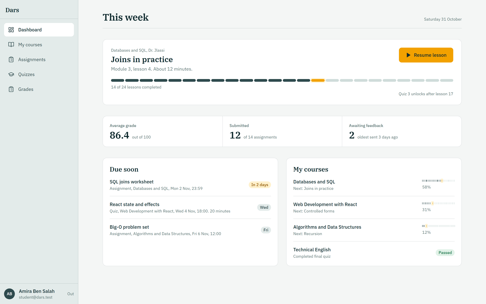
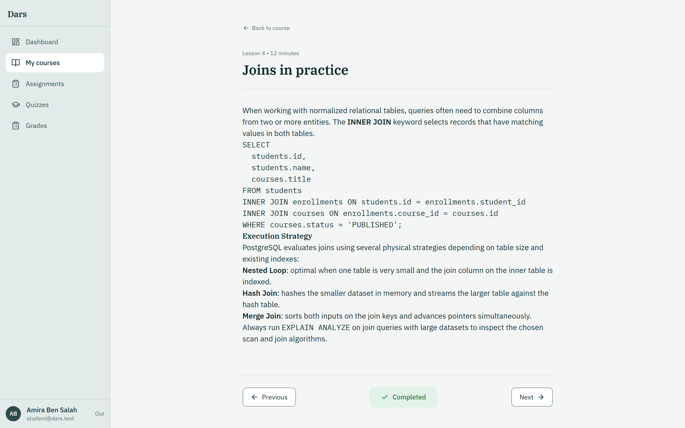
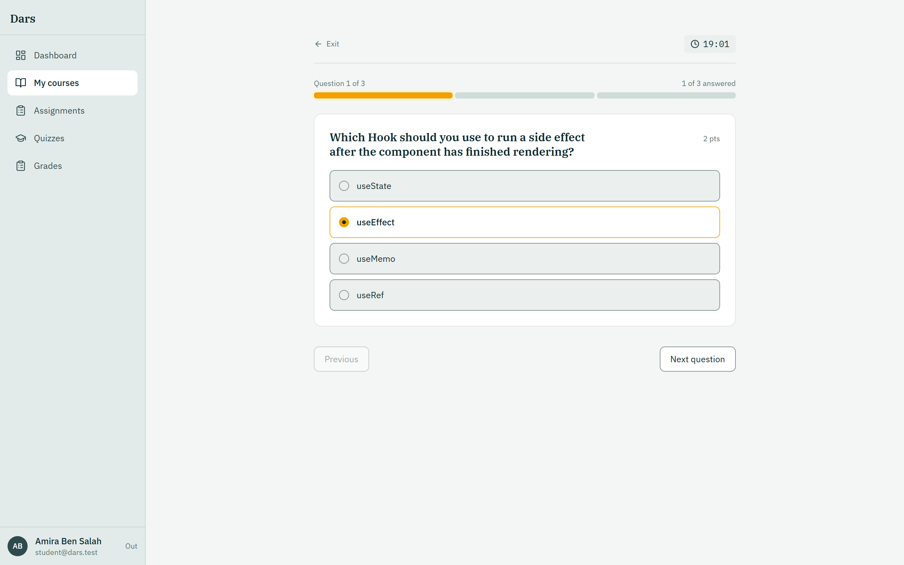
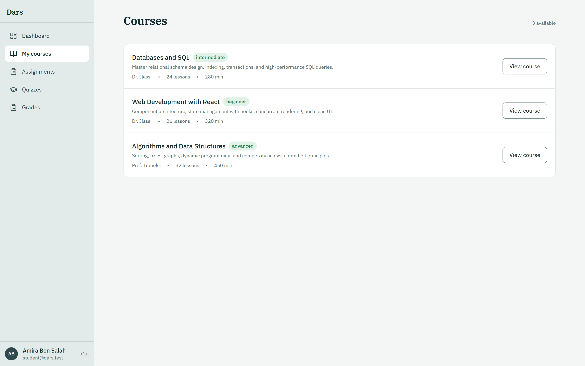
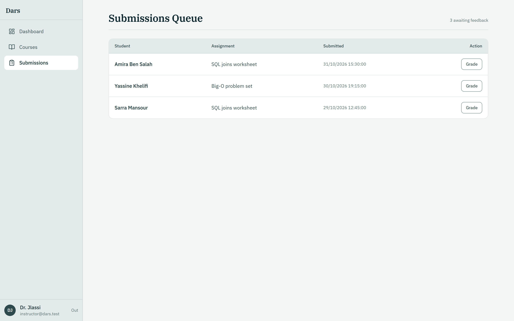
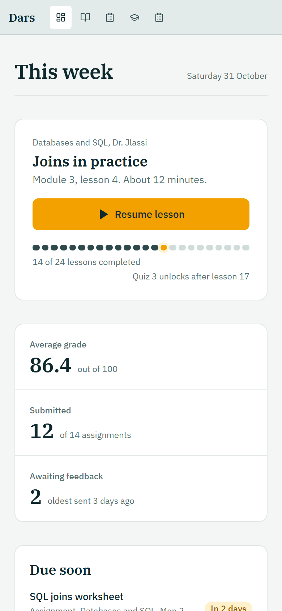
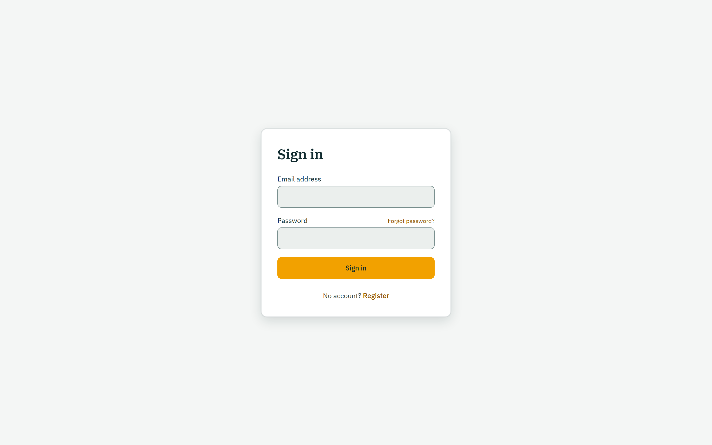

# Dars LMS — Class-Ready Learning Management System

[](https://www.typescriptlang.org/)
[](https://react.dev/)
[](https://nestjs.com/)
[](https://tailwindcss.com/)
[](https://www.postgresql.org/)
[](https://www.prisma.io/)
[](https://www.w3.org/WAI/standards-guidelines/wcag/)
[](LICENSE)

**Dars** (Arabic: **درس**, meaning *"lesson"*) is a modern, high-craft Learning Management System built from the ground up for university classrooms, bootcamps, and professional academies. It provides students with a task-focused operating environment, instructors with rigorous course building and grading workflows, and administrators with comprehensive oversight.

Designed around a calm **Chalk, Board & Pencil** aesthetic, Dars rejects generic SaaS tropes (no purple-indigo gradients, no empty KPI cards, no circular progress rings) in favor of typographical hierarchy and its signature **Lesson Trail**.

---

## 📸 Interface Showcase

### Student Dashboard — The Operating Surface
The central dashboard is built around a single question: *"What should I do next?"* It features the focal **Resume Panel**, **Type-Divided Stat Band**, deadline-prioritized **Due Soon List**, and **My Courses** with compact lesson trails.

<p align="center">
  
</p>

---

### Reading & Assessment Surfaces

| **Lesson Viewer (Prose at 68ch max)** | **Server-Authoritative Quiz Player** |
|:---:|:---:|
|  |  |
| *IBM Plex Serif 400 reading surface with code highlighting and optimistic completion.* | *Segment-strip navigator, countdown timer, polite aria-live alerts, and autosave.* |

| **Course Catalog** | **Instructor Submissions Queue** |
|:---:|:---:|
|  |  |
| *Clean divided rows with enrollment status, level tags, and lesson counts.* | *Oldest-first grading queue with modal grading and constructive feedback.* |

| **Mobile View (390px Responsive)** | **Clean Authentication Surface** |
|:---:|:---:|
|  |  |
| *Collapsible top strip, stacked stat band, and touch-friendly targets.* | *High-contrast form fields with Zod validation and keyboard focus.* |

---

## 🎨 The Signature Design System

Dars implements a strict design system documented in [`docs/DESIGN_SYSTEM.md`](docs/DESIGN_SYSTEM.md) and previewable in [`docs/design-reference.html`](docs/design-reference.html).

### 1. The 60 / 30 / 10 Rule
* **60% Chalk (Dominant Neutral)**: `#FFFFFF` panels/inputs, `#F4F6F5` ground, `#EBEFED` code blocks and sunken cards.
* **30% Board (Secondary Structure)**: `#E3EBEA` sidebar & table bands, `#768D8C` control borders, `#2E4A4D` secondary text, `#0F2A2E` ink.
* **10% Pencil (Accent)**: `#F2A100` primary action, active trail segment with halo, search highlights. **Exactly one primary button per view.**
* **Status Colors**: Leaf (`#1F7A4D`) for passed/published; Redpen (`#B42318`) for overdue/errors.

### 2. IBM Plex Superfamily Typography
* **Serif 600**: Page titles (H1), lesson headers (H2), section titles (H3).
* **Sans 400 / 500 / 600**: Application navigation, buttons, form controls, and tabular tables.
* **Serif 400**: Lesson reading prose (strictly constrained to 68ch line-length).
* **Mono 400**: Code listings, quiz timers, student identifiers, and tabular numbers.

### 3. The Lesson Trail
A segmented progress element where each segment represents a lesson:
* **Completed**: Solid Board (`bg-board-700`)
* **Current**: Vibrant Pencil (`bg-pencil-500`) with subtle halo (`ring-2 ring-pencil-100`)
* **Upcoming**: Quiet Slate (`bg-board-200`)
* Accompanied by full accessible alternative text and milestone alerts (`Quiz 3 unlocks after lesson 17`).

---

## ⚡ Architecture & Technology Stack

Dars is engineered as an enterprise-grade **Modular Monolith** in an npm workspaces monorepo:

```
lms-kit/
├── apps/
│   ├── api/             # NestJS 10, Prisma 5, PostgreSQL 16, Pino, Argon2id
│   └── web/             # React 18, Vite 5, Tailwind CSS 3.4, TanStack Query, Radix UI
├── packages/
│   └── contracts/       # Shared Zod schemas, TypeScript types, and DTO contracts
├── deploy/              # Multi-stage Dockerfiles, Caddy HTTPS, production compose
└── docs/                # Architecture, Security, Design System specs & screenshots
```

### Monorepo Stack Details
| Layer | Technologies |
|---|---|
| **Web Client** | React 18, TypeScript, Vite, React Router 6, TanStack Query 5, Tailwind CSS 3.4, Radix UI primitives, React Hook Form, Zod, Sonner, Lucide |
| **API Backend** | NestJS 10 (modular monolith), Prisma ORM, PostgreSQL 16, Pino Logger, Argon2id, Helmet CSP, EventEmitter2, Throttler |
| **Contracts** | Pure TypeScript + Zod schemas enforcing runtime API request/response contracts |
| **Quality & Tests**| Jest & Supertest (API), Vitest & Testing Library (Web), Playwright (E2E), k6 (Load Testing) |
| **DevOps & Deploy** | Multi-stage Alpine Docker, Caddy 2 (automatic Let's Encrypt HTTPS), Nginx, GitHub Actions |

---

## 🔒 Security & OWASP Compliance

Dars adheres to strict security policies documented in [`docs/SECURITY.md`](docs/SECURITY.md) and verified by 12 comprehensive automated security test suites:

1. **IDOR Defense**: All student submissions, quiz attempts, and grades enforce domain ownership checks. Forbidden objects return `404 Not Found` to prevent resource enumeration.
2. **Strict RBAC & Policies**: Role separation (Student, Instructor, Admin) checked globally by NestJS guards; fine-grained course editing verified in service layer.
3. **No Mass Assignment**: Input DTOs strictly stripped and validated with Zod; registration rejects role tampering.
4. **Token Family Rotation**: Refresh tokens in `httpOnly`, `SameSite=Strict` cookies. Replay detection revokes the entire token family immediately.
5. **Anti-Enumeration**: Identical responses and constant-time behavior across login and forgot-password endpoints.
6. **Server-Authoritative Timing**: Quiz deadlines and time limits are validated by server timestamp with grace window check.
7. **No Answer Key Leakage**: Option `isCorrect` and explanations are omitted from attempt payloads until after submission.
8. **File Upload Hardening**: Magic byte file sniffing (`file-type`), allowed extension white-listing (`.pdf`, `.zip`, `.png`, `.jpg`), and 10MB limits.
9. **XSS Protection**: Markdown sanitized via `rehype-sanitize` with strict HTML element allow-lists.
10. **Rate Limiting**: Throttler limits brute-force attempts on authentication routes (HTTP 429).
11. **Security Headers**: Helmet CSP, `X-Content-Type-Options: nosniff`, `X-Frame-Options: DENY`, `X-Request-ID` propagation.

---

## 🚀 Getting Started

### Prerequisites
- **Node.js**: v20.x or v22.x
- **npm**: v10.x or v11.x
- **Docker Desktop** (or a local PostgreSQL 16 instance)

### 1. Installation
Clone the repository and install dependencies across all workspaces:
```bash
git clone https://github.com/your-org/dars-lms.git
cd dars-lms
npm install
```

### 2. Configure Environment
Create local environment files:
```bash
cp apps/api/.env.example apps/api/.env
```

### 3. Start Database & Seed Realistic Demo Data
If running Docker:
```bash
# Start PostgreSQL 16 and Mailpit
docker compose up -d db mailpit

# Run migrations and seed curriculum
npm run db:migrate
npm run db:seed
```

### 4. Start Development Servers
```bash
npm run dev
```
- **Web App**: [http://localhost:5173](http://localhost:5173)
- **API Server**: [http://localhost:4000](http://localhost:4000)
- **Interactive Swagger Docs**: [http://localhost:4000/api/docs](http://localhost:4000/api/docs)
- **Local Mailpit Inbox**: [http://localhost:8025](http://localhost:8025)

---

## 👥 Demo Accounts (Development Seed)

| Role | Email | Password | Access Highlights |
|---|---|---|---|
| **Student** | `student@dars.test` | `DarsDemo-2026` | Enrolled in 4 courses, in-progress lesson, pending quiz attempt |
| **Instructor** | `instructor@dars.test` | `DarsDemo-2026` | Course builder, module manager, submissions grading queue |
| **Administrator** | `admin@dars.test` | `DarsDemo-2026` | User role management, audit log inspection, platform stats |

---

## 🛠️ Verification & Test Suite

Run the full verification suite across the monorepo:

```powershell
# 1. ESLint (Zero warnings allowed)
npm run lint

# 2. Strict TypeScript check across all packages
npm run typecheck

# 3. Unit and component tests (Vitest)
npm run test --workspace=apps/web

# 4. API End-to-End tests (Jest)
npm run test:e2e --workspace=apps/api

# 5. Production builds (Vite + NestJS)
npm run build --workspace=packages/contracts
npm run build --workspace=apps/web
npm run build --workspace=apps/api

# 6. k6 Load Testing (p95 < 200ms)
npm run perf:load
```

---

## 🚢 Production Deployment

Dars is containerized using multi-stage, hardened Alpine Docker images:

```bash
# 1. Setup production environment
cp deploy/.env.production.example deploy/.env.production

# 2. Build and launch services behind Caddy reverse proxy
docker compose -f deploy/docker-compose.prod.yml --env-file deploy/.env.production up -d --build

# 3. Apply database migrations
docker compose -f deploy/docker-compose.prod.yml exec api npx prisma migrate deploy
```

Automated daily backup and recovery procedures are documented in [`deploy/RESTORE.md`](deploy/RESTORE.md).

---

## 📄 License
This project is open-source under the [MIT License](LICENSE).
