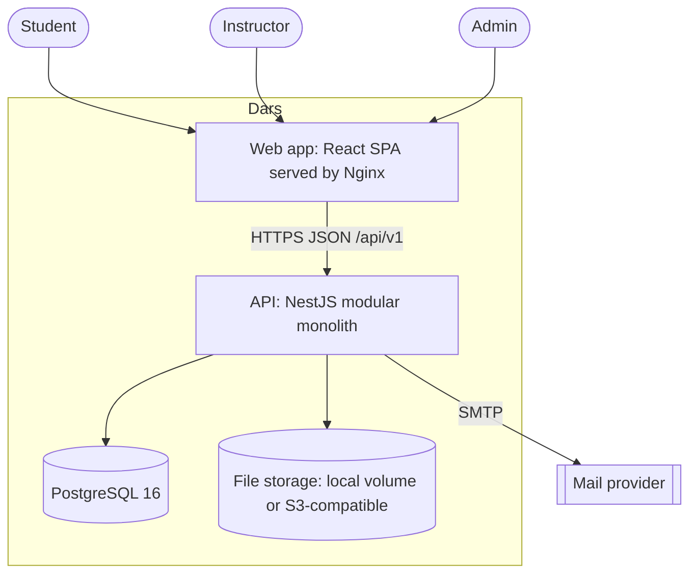
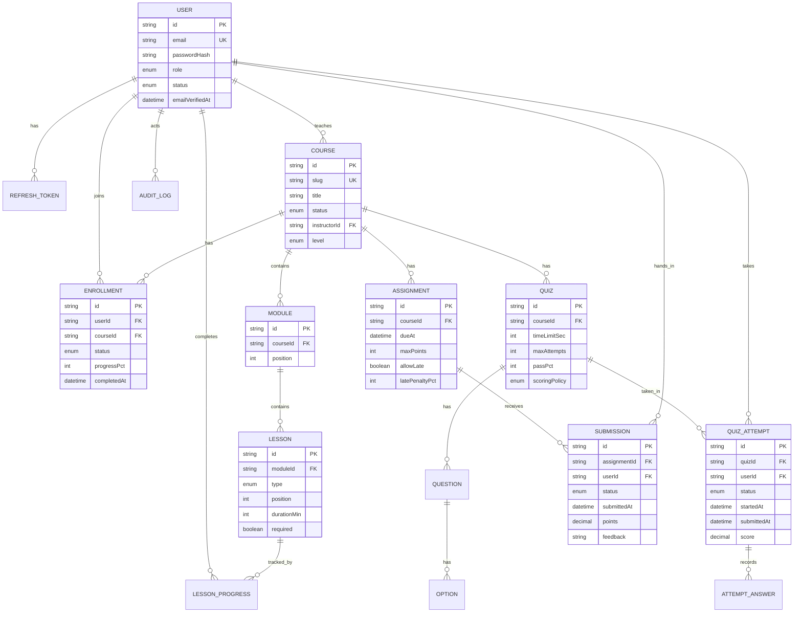
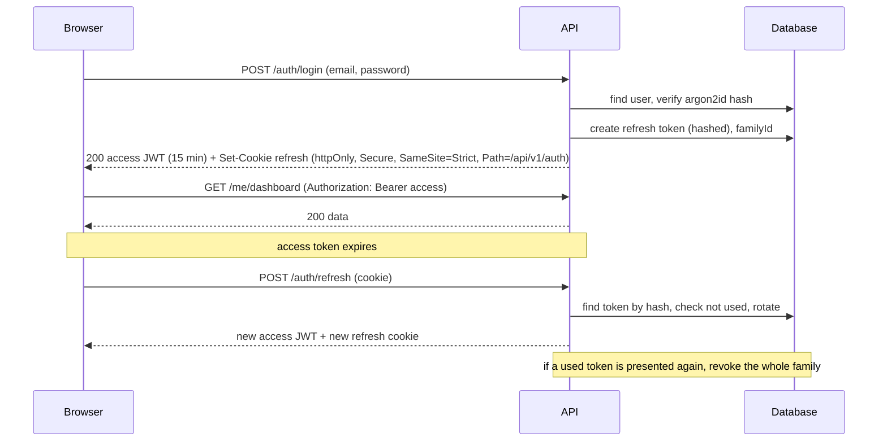
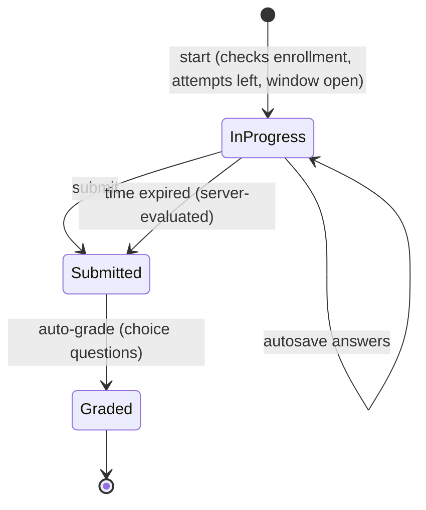
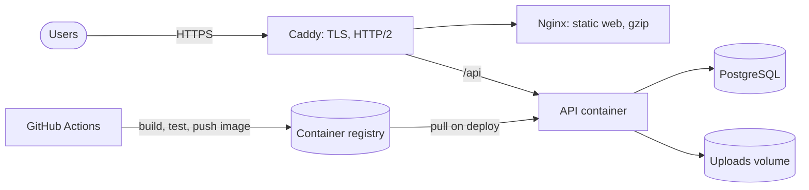

# Architecture: Dars LMS

## 1. Goals and quality attributes

| Attribute | Target |
|---|---|
| Security | Safe by default: OWASP ASVS L2 mindset, least privilege, no answer or personal data leaks |
| Correctness | Grades, progress and quiz timing are computed on the server and are reproducible |
| Maintainability | Clear module boundaries a new developer understands in an hour |
| Performance | API p95 under 200ms for list endpoints at seed scale. Web LCP under 2.5s, JS initial under 180KB gzipped |
| Testability | Business rules testable without HTTP or a database |
| Operability | One command to run locally, health checks, structured logs, repeatable deploys |

Design scale: 5,000 students, 200 courses, 50 concurrent quiz takers, 10 GB of uploads. One small server handles this. The architecture documents the path beyond it (section 12).

## 2. Architectural style: modular monolith

One deployable API, internally split into modules with enforced boundaries. This gives the clarity of services without network failure modes, distributed transactions or operational cost (ADR-001).

Modules and their responsibility:

| Module | Owns |
|---|---|
| `auth` | Registration, login, tokens, refresh rotation, password reset, email verification |
| `users` | Profiles, roles, account status |
| `courses` | Course catalog, status (draft, published, archived), ownership |
| `content` | Modules and lessons, ordering, lesson bodies |
| `enrollments` | Who is in which course |
| `assessments` | Quizzes, questions, attempts, assignments, submissions |
| `grading` | Scores, feedback, gradebook queries |
| `progress` | Lesson completion, course progress, dashboard read model |
| `files` | Storage abstraction, upload validation, authorized download |
| `audit` | Append-only audit log of sensitive actions |
| `admin` | Platform overview, user management |

**Dependency rules**

1. A module may import another module's **public service interface** (`index.ts` exports) and `packages/contracts`. Never another module's repository or Prisma model access.
2. Cross-module reactions use **in-process domain events** (`lesson.completed`, `quiz.graded`, `submission.graded`, `enrollment.created`). `progress` listens, it is not called by `assessments`.
3. No circular module dependencies (enforced with `eslint-plugin-boundaries` or `dependency-cruiser` in CI).

## 3. System context and containers



## 4. Layering inside a module

```
controller   (HTTP only: parse, call service, shape response)
  -> service (use cases, business rules, transactions, emits events)
    -> repository (the only code that talks to Prisma)
policy       (authorization decisions, pure functions: canEditCourse(user, course))
dto/schemas  (Zod, shared from packages/contracts, inferred types)
```

Controllers never contain rules. Services never import Express or Nest HTTP types. Policies are pure and unit-tested.

## 5. Data model



**Constraints and indexes (required)**

- Unique: `User.email` (lowercase), `Course.slug`, `Enrollment(userId, courseId)`, `LessonProgress(userId, lessonId)`, `Submission(assignmentId, userId)` (one live submission, history in `SubmissionVersion` if resubmission is allowed), `Module(courseId, position)`, `Lesson(moduleId, position)`.
- Indexes: `Course(status, createdAt)`, `Enrollment(userId, status)`, `QuizAttempt(userId, quizId, status)`, `Submission(assignmentId, status)`, `AuditLog(actorId, createdAt)`, `RefreshToken(familyId)`, `RefreshToken(tokenHash)`.
- Foreign keys with explicit `onDelete` (cascade only for owned children such as modules to lessons). Deleting a user is a soft delete or anonymization to preserve grades.
- Money-like precision: scores are `Decimal(6,2)`. Timestamps are UTC, stored as `timestamptz`.

## 6. Authentication and session design



- Access token: JWT, 15 minutes, held **in memory** only (never localStorage). Claims: `sub`, `role`, `iat`, `exp`, `jti`.
- Refresh token: random 256-bit opaque value, stored as SHA-256 hash, 7 days, **rotated on every use**, with reuse detection that revokes the family.
- Passwords: argon2id. Login errors never reveal whether the email exists. Rate limits and backoff per IP and per account.
- Details and threat model are in [SECURITY.md](SECURITY.md).

## 7. Authorization

Two layers, both mandatory:

1. **Role guard** at the route (`@Roles(Role.INSTRUCTOR)`).
2. **Ownership and membership policy** in the service (an instructor edits only their own courses, a student reads lessons only of courses they are enrolled in, a student sees only their own attempts and submissions). Every query that touches user-owned data is scoped by user or enrollment in the repository call. This prevents IDOR by construction.

| Action | Student | Instructor | Admin |
|---|---|---|---|
| Browse published catalog | yes | yes | yes |
| Enroll and unenroll self | yes | no | no |
| Read lessons | enrolled only | own courses | all |
| Mark lesson complete | self | no | no |
| Create and edit course | no | own | all |
| Publish or archive course | no | own | all |
| Create quizzes and assignments | no | own courses | all |
| Take quiz, submit assignment | enrolled only | no | no |
| Grade submissions | no | own courses | all |
| View gradebook | own grades | own courses | all |
| Manage users and roles | no | no | yes |
| View audit log | no | no | yes |

## 8. Core flows

### 8.1 Quiz attempt



- The server stores `startedAt` and computes the deadline (`startedAt + timeLimit + 5s grace`). The client timer is cosmetic.
- Correct answers and explanations are **never** sent while an attempt is `InProgress`. Option order is shuffled per attempt from a stored seed.
- Submit is **idempotent**. Expired attempts are closed lazily on the next request and by a periodic sweep.
- Scoring policy per quiz: best, last or average of attempts.

### 8.2 Assignment lifecycle

`Not submitted -> Submitted (or Late) -> Graded -> Returned`. Resubmission is allowed until the due date (or until graded, per setting) and keeps a version history. Late submissions apply `latePenaltyPct` automatically when `allowLate` is true. Files are validated by type, size and magic bytes before storage.

### 8.3 Progress

`progressPct = completed required items / total required items`, where items are required lessons, quizzes (passed) and assignments (submitted). It is stored on `Enrollment` as a denormalized read model, updated in the same transaction as the triggering event, and can be recomputed by a maintenance command. Course completion sets `completedAt` once.

## 9. API conventions

- Base path `/api/v1`. JSON only (plus multipart for uploads). OpenAPI generated from code at `/api/docs` (disabled or protected in production).
- Success: `{ data, meta? }`. Error: `{ error: { code, message, fields?, requestId } }`. Status codes: 200, 201, 204, 400, 401, 403, 404, 409, 422, 429, 500.
- Pagination by `page` and `limit` (default 20, maximum 100), sorting by allow-list, filters validated by Zod.
- Every request has a `requestId` (propagated to logs and error responses).
- Write endpoints that can be retried (submit quiz, submit assignment) are idempotent.

### Endpoint catalog

| Module | Endpoints |
|---|---|
| auth | `POST /auth/register`, `/auth/login`, `/auth/refresh`, `/auth/logout`, `/auth/verify-email`, `/auth/forgot-password`, `/auth/reset-password`. `GET /auth/me` |
| users | `PATCH /me`, `POST /me/password`. Admin: `GET /users`, `PATCH /users/:id/role`, `PATCH /users/:id/status` |
| courses | `GET /courses`, `GET /courses/:slug`, `POST /courses`, `PATCH /courses/:id`, `POST /courses/:id/publish`, `POST /courses/:id/archive`, `DELETE /courses/:id` (draft only) |
| content | `POST /courses/:id/modules`, `PATCH /modules/:id`, `DELETE /modules/:id`, `PATCH /courses/:id/modules/reorder`, `POST /modules/:id/lessons`, `GET /lessons/:id`, `PATCH /lessons/:id`, `DELETE /lessons/:id`, `PATCH /modules/:id/lessons/reorder` |
| enrollments | `POST /courses/:id/enroll`, `DELETE /courses/:id/enroll`, `GET /me/enrollments`, `GET /courses/:id/students` |
| progress | `PUT /lessons/:id/progress`, `GET /me/progress`, `GET /courses/:id/progress`, `GET /courses/:id/progress/summary` |
| dashboard | `GET /me/dashboard` (resume target, due soon, stats, courses, one aggregated call) |
| assessments | `POST /courses/:id/quizzes`, `PATCH /quizzes/:id`, questions CRUD, `POST /quizzes/:id/attempts`, `PUT /attempts/:id/answers`, `POST /attempts/:id/submit`, `GET /attempts/:id`. `POST /courses/:id/assignments`, `PATCH /assignments/:id`, `POST /assignments/:id/submissions` |
| grading | `GET /assignments/:id/submissions`, `PATCH /submissions/:id/grade`, `GET /courses/:id/gradebook`, `GET /me/grades` |
| files | `GET /files/:id` (authorized stream or short-lived signed URL) |
| admin | `GET /admin/overview`, `GET /admin/audit-log` |
| ops | `GET /health` (liveness), `GET /ready` (database reachable) |

## 10. Non-functional design

**Performance**
- Dashboard is one aggregated query set, not N calls. Use `select` and `include` deliberately to avoid N+1. Review query plans for list endpoints.
- Cache: HTTP `ETag` and `Cache-Control` on catalog reads, TanStack Query `staleTime` on the client. No Redis in v1 (ADR-005).
- Web: route-level code splitting, lazy images, font subsetting, preload the two primary faces, compression (gzip or brotli) at Nginx.

**Observability**
- Structured JSON logs (pino) with `requestId`, user id (never email or other personal data), route, status, duration.
- `/health` and `/ready`. Basic request metrics at `/metrics` (Prometheus format) when enabled.

**Resilience**
- Request timeouts, body size limits, graceful shutdown (drain on `SIGTERM`), database connection pool sized for the instance, migrations run as a separate step before the new version takes traffic.

**Data protection**
- Personal data minimized and never logged. Account export and deletion supported. Daily database backup with a documented restore test. Uploaded files are not served directly from the web root.

## 11. Deployment architecture



Environments: `local` (docker compose with Postgres and a mail catcher), `staging`, `production`. Same images in all of them, configuration only through environment variables. Details in [README.md](../README.md#deployment).

## 12. Scalability path (what changes at 10x)

| Pressure | Change |
|---|---|
| More than one API instance | Add Redis for rate limiting and refresh-token revocation cache, sticky sessions are not needed (stateless API) |
| Slow emails, exports, bulk grading | Add a job queue (BullMQ on Redis), move email and export work off the request path |
| Heavy reads | Read replica, materialized views for gradebook, CDN for static assets and signed file URLs |
| File growth | Move uploads to S3-compatible storage (the `StorageService` interface already allows it) |
| Team growth | Extract the module with the clearest boundary and highest load (likely `assessments`) behind its public interface and events |

## 13. Architecture decision records

| ADR | Decision | Why | Alternatives rejected |
|---|---|---|---|
| 001 | Modular monolith | Team size and scale do not justify the cost of microservices. Boundaries are enforced in code | Microservices (operational overhead), unstructured monolith (decay) |
| 002 | NestJS | Built-in modules, DI, guards and OpenAPI map directly to the architecture | Express without structure (conventions drift), Fastify bare |
| 003 | PostgreSQL with Prisma | Relational data with strong constraints, migrations and typed queries | MongoDB (relations and transactions matter here) |
| 004 | Access JWT in memory plus rotating refresh cookie | Limits XSS exposure of long-lived credentials, supports revocation and reuse detection | Long-lived JWT in localStorage, server sessions only |
| 005 | No Redis in v1 | One instance does not need it. Reduces moving parts | Add on day one (premature) |
| 006 | Shared Zod contracts package | One definition of every request and response, validated on both sides | Duplicated types on client and server |
| 007 | Server-authoritative quiz timing and grading | Client clocks and payloads cannot be trusted | Client-side timer and scoring |
| 008 | Denormalized `Enrollment.progressPct` | Dashboard reads stay O(courses), recomputable if wrong | Compute on every read |
| 009 | Storage behind an interface | Local disk now, S3 later without touching callers | Direct filesystem calls |
| 010 | Docker Compose and Caddy for deployment | Reproducible, cheap, automatic HTTPS, teachable | Kubernetes (excessive for this scale) |

New decisions get a new row (or a file in `docs/adr/`) in the same change that introduces them.

## 14. Repository structure

```
.
├── apps/
│   ├── api/                       NestJS
│   │   ├── prisma/                schema.prisma, migrations/, seed.ts
│   │   └── src/
│   │       ├── main.ts, app.module.ts
│   │       ├── common/            filters, guards, interceptors, decorators, pipes
│   │       ├── config/            env validation
│   │       ├── infra/             prisma, storage, mailer, logger, events
│   │       └── modules/<name>/    controller, service, repository, policy, events, tests
│   └── web/                       React SPA
│       └── src/
│           ├── app/               router, providers, shell
│           ├── components/ui/     design-system primitives
│           ├── features/<name>/   api, components, hooks, pages
│           ├── lib/               http client, formatting, auth store
│           └── styles/            tokens.css, globals.css
├── packages/contracts/            Zod schemas, DTO types, enums, error codes
├── docs/                          ARCHITECTURE, DESIGN_SYSTEM, SECURITY, design-reference.html
├── deploy/                        Dockerfiles, compose files, Caddyfile, nginx.conf
└── .agents/                       rules, skills, workflows
```
